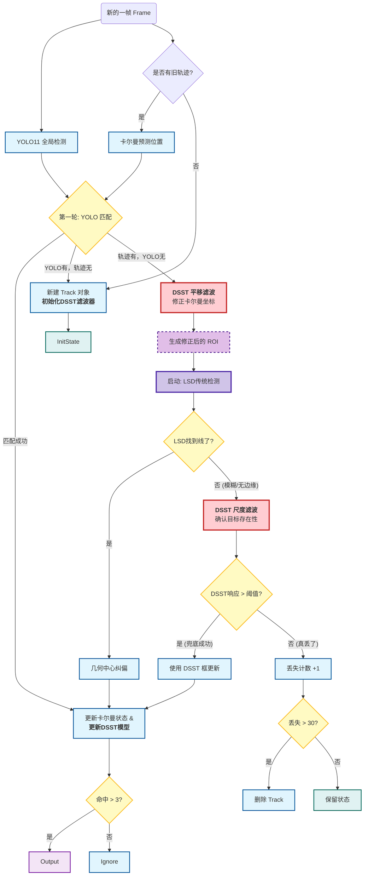

![[DSST.png]]
# 1. 背景与痛点 (Background & Motivation)
## 1.1 传统相关滤波的短板：只能“平移”，不懂“缩放”
在这篇论文发表之前，以 MOSSE 和 CSK 为代表的相关滤波（Correlation Filter）跟踪器非常火。它们的特点是**极快**（几百 FPS），核心思想是在频域计算两个信号的相似度。
但是，它们有一个致命的弱点：**固定模板大小**。
- **平移检测（Translation）**：如果目标只是在画面中上下左右移动，相关滤波器能完美地找到响应峰值，锁定位置 $(x, y)$。
- **尺度变化（Scale Variation）**：如果目标因为摄像机拉近或者物体走近而**变大**，或者远离而**变小**，传统的滤波器就傻眼了。因为它手里的“模板”大小是死的 。
## 1.2 视觉证据：由“大”变“小”的挑战
![[DSSTfigure1.png]]
**场景分析**：
- 第一行（CarScale）：汽车从远处的风景中驶来，体积迅速变大。
- 第二行（David）：人脸在画面中前后移动，产生尺度变化。
 **对比**：
- **红色框（Ours/DSST）**：始终紧紧包围目标，框的大小随着目标大小自适应变化 。   
- **其他颜色框**：例如蓝色或绿色框，往往还是原来的大小，导致要么只能框住目标的一小部分（如车头），要么框进了很多背景。
![[DSSTfigure3a.png]]
**场景分析**：在 `doll` 和 `dog` 序列中，手持玩偶快速旋转并前后移动。
**痛点**：由于尺度变化快，ASLA 和 SCM 算法（图中蓝色和绿色线）虽然能应对一定变化，但容易发生漂移（Drift）。而 DSST（红色粗线）能够准确估计尺度和位置。
## 1.3   
论文指出，现有的能做尺度估计的方法通常**太慢了**（帧率低，不满足实时性）。 DSST 的核心目标就是：**在保持相关滤波极快速度（实时性）的同时，还能精准地算出来目标缩放了多少倍。**
# 2. 多维特征相关滤波的数学原理
这就好比：以前只靠“黑白照片”找人，现在不仅看黑白，还看“轮廓纹理”，信息量大增。

我们要解决的核心问题是：如何训练一个滤波器 $h$，使得它作用在输入图像 $f$ 上时，输出的结果尽可能接近我们预设的完美高斯峰值 $g$。
## 2.1 训练目标（损失函数）
假设我们的特征有 $d$ 个维度（例如 HOG 特征可能有 31 个维度）。我们要找到一组滤波器 $h^l$（每个维度一个），最小化以下误差：
$$\epsilon = ||\sum_{l=1}^{d}h^{l}*f^{l}-g||^{2} + \lambda\sum_{l=1}^{d}||h^{l}||^{2}$$
**直观解释**：
- 第一项 $||\dots||^2$：让滤波器的输出结果（预测值）与理想的高斯函数 $g$（真值）尽可能一致。
- 第二项 $\lambda \sum \dots$：**正则化项**。防止滤波器太复杂（过拟合），也防止分母为零的问题 。
- $*$：表示卷积运算。
## 2.2 闭式解（在频域计算）
直接在空域做卷积太慢了。根据卷积定理，我们将所有变量变换到**频域**（傅里叶变换，用大写字母表示），上述公式的解变得非常简单优雅：
$$H^{l} = \frac{\overline{G}F^{l}}{\sum_{k=1}^{d}\overline{F^{k}}F^{k}+\lambda}$$

- $H^l$：第 $l$ 个维度的最佳滤波器（在频域）。
- $F^l$：当前输入图像的第 $l$ 个维度的特征（在频域）。
- $\overline{G}$：理想输出 $G$ 的复共轭。
- **注意**：分子是针对每个维度的，但分母是**所有维度的能量之和**，这让不同维度的特征联合起来起作用。
## 2.3 模型的更新（记忆机制）
为了让跟踪器能适应目标外观的变化（比如人转头了），我们不能只看当前这一帧。我们需要“记住”过去的样子。作者通过分别更新分子（设为 $A$）和分母（设为 $B$）来实现：
$$A_{t}^{l} = (1-\eta)A_{t-1}^{l} + \eta\overline{G}_{t}F_{t}^{l}$$
$$B_{t} = (1-\eta)B_{t-1} + \eta\sum_{k=1}^{d}\overline{F_{t}^{k}}F_{t}^{k}$$
- $\eta$（Learning Rate）：学习率。决定了我们多大程度上相信新的一帧，还是保留旧的记忆。
- $t$：代表时间步（当前帧）。
## 2.4 检测（定位目标）
当新的一帧图像到来，我们提取出特征 $Z$，如何找到目标？

我们将训练好的滤波器 $H$ 与新特征 $Z$ 进行相关运算，得到响应图 $y$：
$$y = \mathcal{F}^{-1} \{ \frac{\sum_{l=1}^{d}\overline{A^{l}}Z^{l}}{B+\lambda} \ \}$$

- $\mathcal{F}^{-1}$：快速傅里叶逆变换（IFFT）。
- **结果**：$y$ 是一个响应图（Heatmap），图中**数值最大**的点，就是目标最可能所在的位置。
## 2.5 总结
DSST 处理多维特征的核心引擎。不管是平移滤波器还是尺度滤波器，用的都是这一套数学公式。
- **输入**：多通道特征 $f$。
- **处理**：转到频域，用公式更新分子 $A$ 和分母 $B$。
- **输出**：响应图 $y$，峰值即为目标。

我们要解决的**核心问题是**：如何训练一个滤波器 $h$，使得它作用在输入图像 $f$ 上时，输出的结果尽可能接近我们预设的完美高斯峰值 $g$。
- $g$ 是我们给滤波器设定的**标准答案**或**靶心**。
### 2.5.1 为什么要这个 $g$？（Why）
- **$g$ 的作用是“教会”滤波器：** “当你看到图像 $f$（比如一只猫的图片）时，你必须给我输出一个像 $g$ 一样的波形——猫鼻子的位置要是峰值，旁边要低下去。
### 2.5.2  $g$ 用于什么？（Usage）
它用于**计算误差（Loss Function）**，从而指导滤波器的修正。
回顾公式：
$$\epsilon = || \sum h * f - g ||^2$$
- $h * f$ 是滤波器当前的**实际表现**。
- $g$ 是我们期望的**理想表现**。
- $\epsilon$ 是它们之间的**差距**。
我们在训练过程中，就是在不断调整 $h$ 的参数，试图让“实际表现”无限接近“理想表现” $g$。一旦训练好了，下次来一张新图片，滤波器算出的结果就会在目标位置自动“冒”出一个尖峰。
### 2.5.3 为什么偏偏是“高斯”函数？
虽然理论上只要是峰值就行，但高斯函数（像一个小山丘形状）有两个巨大的好处：
1. **容错性（Robustness）**：如果我们用一个针尖一样的点（Delta函数，中心是1，旁边全是0），那要求太苛刻了。稍微一点像素偏移，误差就巨大。高斯函数有一个平缓的坡度，允许一点点模糊和误差，让训练更稳定。
2. **数学便利**：高斯函数的傅里叶变换依然是高斯函数，计算起来非常漂亮且高效。
# 3. 核心创新——尺度滤波器 (The Scale Filter)
通常要解决“变大变小”的问题，我们容易想到笨办法，但作者设计了一个极其聪明的**分步走策略**。
## 3.1 方案 A：笨办法——穷举式 3D 搜索 (Exhaustive Scale Search)
这是作者首先尝试但最终为了速度而优化的方案。
- **思路**：把“尺度”当成图像的第三个维度，就像 $(x, y, z)$ 一样。
- **做法**：
    1. 不仅提取当前大小的特征，还提取比它大一点、小一点、再小一点的特征...以此类推，比如搞 33 层。
    2. 这就在特征空间里堆成了一个 **3D 立方体**（长 $\times$ 宽 $\times$ 尺度层数）。
    3. 训练一个 **3D 滤波器** 去在这个立方体里找目标。
- **缺点**：太慢了！计算量是原来的几十倍（因为层数 $S$ 通常取 33 层）。这就失去了相关滤波“极快”的优势。
## 3.2 聪明办法——快速尺度空间跟踪 (Fast Scale Space Tracking)
这是 DSST 的核心方案。作者利用了一个关键的生活经验：**物体移动通常很快，但变大变小通常比较平缓。**
因此，DSST 提出了**位置-尺度解耦(Decoupling)** 策略：
> **核心口诀**：先定位置，再定大小。
### 3.2.1 **第一步（平移滤波器 $h_{trans}$）**：
- 先假设目标大小没变。
- 用标准的 2D 相关滤波器（就是步骤 2 讲的那个）在当前图像上扫一遍。
- 找到响应最大的位置 $(x, y)$。此时我们锁定了目标的**中心**，但框的大小可能还没对准 。
### 3.2.2 **第二步（尺度滤波器 $h_{scale}$）**：
- **固定中心**：锁定刚才找到的 $(x, y)$ 不动。
- **多级采样**：以这个中心为圆心，抠出 **33 张**（论文中 $S=33$）不同大小的图片。有的框很小，有的框很大 。
- **统一格式**：把这 33 张图片全部缩放到统一的固定尺寸（比如 $128 \times 128$），提取 HOG 特征 。
- **1D 滤波**：这时候，我们就有了一个长度为 33 的“特征序列”。我们用一个 **1D 滤波器** 在这个序列上扫一遍。
- **结果**：如果第 16 个位置响应最大，说明不用缩放；如果第 20 个位置最大，说明目标变大了（对应那一层的缩放比例）。
## 3.3 深度解析：如何构建“尺度金字塔”
为了让你理解这“33 层”是怎么来的，我们来看数学描述：
假设目标当前大小是 $P \times R$（比如 $100 \times 50$）。
我们要检测 $S$ 个不同的尺度层级。对于每一层 $n$（$n$ 从 $-\lfloor \frac{S-1}{2} \rfloor$ 到 $\lfloor \frac{S-1}{2} \rfloor$）：
### 3.3.1 计算采样框大小：
$$\text{Size}_n = a^n P \times a^n R$$
其中 $a$ 是缩放因子（论文设为 $1.02$）。
- $n=0$：原大小 ($100 \times 50$)
- $n=1$：大一点 ($1.02 \times 100 \times 50$)
- $n=-1$：小一点 ($0.98 \times 100 \times 50$)
- ...一直乘下去，这就构成了**尺度金字塔**。
### 3.3.2 特征提取：
从图像中抠出这些 $J_n$ 块，全部 resize 到固定大小，提取特征向量。这就把“尺度变化”转化为了特征向量的“内容变化”。
### 3.3.3 寻找最佳尺度：
应用 1D 相关滤波器公式：
$$y_{scale} = \mathcal{F}^{-1} \{ \frac{\sum_{l=1}^{d} \overline{A^l_{scale}} Z^l_{scale}}{B_{scale} + \lambda} \}$$
得到的 $y_{scale}$ 是一个有 33 个数值的数组。**最大值的索引**直接告诉我们要把目标框放大或缩小多少倍 。
## 3.4 总结
DSST 的精髓在于**不蛮干**。 它不试图一次性算出 $(x, y, s)$，而是先用 2D 滤波器算 $(x, y)$，再在这个位置通过“放大缩小取样”构建一个虚拟的 1D 信号，用 1D 滤波器算 $s$。

这使得它的速度比穷举法快了 **25 倍**，同时精度极高 。
![[DSSTtable1.png]]
# 4. 算法流程 (Algorithm Workflow)
整个过程形成一个闭环：**输入上一帧状态 $\rightarrow$ 估计位置 $\rightarrow$ 估计尺度 $\rightarrow$ 更新模型 $\rightarrow$ 输出当前帧状态**
## 4.1  输入与初始化 (Input)
- **当前帧图像**：$I_t$
- **上一帧的目标位置**：$p_{t-1}$（即 $(x, y)$ 坐标）
- **上一帧的目标尺度**：$s_{t-1}$（即目标的宽和高）
- **训练好的模型**：
    - 平移滤波器模型：$A_{t-1}^{trans}, B_{t-1}^{trans}$
    - 尺度滤波器模型：$A_{t-1}^{scale}, B_{t-1}^{scale}$
## 4.2 第一阶段：位置估计 (Translation Estimation)
**目标**：先不管目标变没变大，先找到它去哪了。
### 4.2.1 **采样 (Extraction)**：
- 在上一帧的位置 $p_{t-1}$ 和尺度 $s_{t-1}$ 处，从图像 $I_t$ 中提取特征图 $z_{trans}$ 。
	- _注：这里通常提取 HOG 特征 + 灰度特征。_
### 4.2.2 **检测 (Correlation)**：
 使用平移滤波器计算响应图：
$$y_{trans} = \mathcal{F}^{-1} \{ \frac{\sum \overline{A^{trans}} Z^{trans}}{B^{trans} + \lambda} \}$$
### 4.2.3 **定位 (Maximize)**：
- 在响应图 $y_{trans}$ 中找到**峰值（最大值）**的位置。
- 更新目标位置为 $p_t$ 。
## 4.3 第二阶段：尺度估计 (Scale Estimation)
**目标**：位置已经锁定了，现在看看它缩放了多少。
### 4.3.1 **构建金字塔 (Pyramid Extraction)**：
- 以**新位置** $p_t$ 为中心，用上一帧的尺度 $s_{t-1}$ 为基准。
- 提取 33 个不同缩放比例的图像块（比如从 $0.98^{16}$ 倍到 $1.02^{16}$ 倍）。
- 将这 33 个块缩放到统一大小，提取特征，组成特征向量 $z_{scale}$ 。
### 4.3.2 **检测 (Correlation)**：
- 使用尺度滤波器计算响应：
$$y_{scale} = \mathcal{F}^{-1} \{ \frac{\sum \overline{A^{scale}} Z^{scale}}{B^{scale} + \lambda} \}$$
- 这里的 $y_{scale}$ 是一个一维数组。
### 4.3.3 **定尺 (Maximize)**：
- 找到 $y_{scale}$ 中最大值的索引（比如第 20 个值最大）。
- 根据索引算出对应的缩放因子，更新目标尺度为 $s_t$ 。
## 4.4 第三阶段：模型更新 (Model Update)
**目标**：让滤波器学习目标在当前帧这一刻的样子（Appearance），防止目标变形导致跟丢。
### 4.4.1 **提取样本**：
- 在**最新的**位置 $p_t$ 和尺度 $s_t$ 处，提取新的训练样本 $f_{trans}$ 和 $f_{scale}$ 。
### 4.4.2 **更新记忆**：
 - 使用学习率 $\eta$ 更新两个滤波器的分子和分母：
    - $A_t^{trans} = (1-\eta)A_{t-1}^{trans} + \eta \overline{G} F_{trans}$
    - $B_t^{trans} = (1-\eta)B_{t-1}^{trans} + \eta \sum \overline{F_{trans}} F_{trans}$ 。
- 尺度滤波器同理更新。
# 5. 总结与优化
## 5.1 DSST 论文核心知识点汇总

| **模块/概念**    | **核心原理描述**                                                                                                                  | **解决什么痛点 (Motivation)**                      |
| ------------ | --------------------------------------------------------------------------------------------------------------------------- | -------------------------------------------- |
| **1. 核心问题**  | 传统相关滤波（如 MOSSE/CSK）模板大小固定，无法适应目标变大变小。                                                                                       | 目标靠近或远离摄像头时，跟踪框失效，导致漂移。                      |
| **2. 数学基石**  | **多维特征相关滤波**。  在频域通过最小化输出误差 $\epsilon$ 来训练滤波器 $H$。  公式：$H = \frac{\overline{G}F}{\sum \overline{F}F + \lambda}$ | 单一灰度特征不够鲁棒，引入 HOG 等多维特征能抗光照变化和模糊。            |
| **3. 核心策略**  | **位置-尺度解耦 (Decoupling)**。  将跟踪分为两步： 1. 先用 2D 滤波器定中心 $(x,y)$。 2. 再用 1D 滤波器定缩放 $s$。                               | 避免了在 3D 空间（x, y, scale）进行穷举搜索，大幅降低计算量，保证实时性。 |
| **4. 尺度滤波器** | **尺度金字塔 (Scale Pyramid)**。  以目标为中心，提取 33 种不同大小的 patch，缩放到统一尺寸，构建 1D 特征向量进行相关检测。                                       | 将“几何上的缩放”转化为“特征内容的变化”，从而用分类器来精确预测最佳尺度。       |
| **5. 性能表现**  | 相比穷举法，速度快 25 倍；相比无尺度估计的基线，中值重叠率 (OP) 提升很大。                                                                                  | 在保证极高精度（适合精密操作）的同时，依然能在普通 CPU 上实时运行。         |
## 5.2 对现有算法的优化建议
现在有方案
- DeepSORT
- 补偿算法
### 5.2.1 现有流图的潜在痛点 (Pain Points)
在DeepSORT的图中，`Unmatched Track` -> `GetROI` -> `RunTrad` 这一条线是用来处理 YOLO 漏检的。这里存在三个隐患：
1. **ROI 盲目性 (GetROI)**:
    - **现状**: 仅仅依靠卡尔曼预测。卡尔曼是基于运动学（惯性）的，它**看不见**图像。如果物体在 YOLO 漏检期间突然急停或转向，卡尔曼预测的 ROI 就会飘走，导致你后续的“传统检测”在错误的地方瞎找。
    - **DSST 作用**: DSST 是**看图像**的。它能根据上一帧的纹理，在这一帧准确地咬住目标位置，修正卡尔曼的盲目预测。
2. **传统方法的脆弱性 (RunTrad)**:
    - **现状**: 你之前的描述中，传统方法是 LSD（线段检测）。LSD 极其依赖**清晰的边缘**。如果 YOLO 是因为运动模糊、光照太暗或对比度太低而漏检，那么 LSD 大概率也会失败（因为边缘也没了）。
    - **DSST 作用**: DSST 依赖的是 HOG 特征（梯度分布），它不需要清晰的边缘线，只要物体大致的纹理还在，它就能算出响应峰值。
3. **尺度失真**:
    - **现状**: 卡尔曼滤波预测框的大小变化通常很迟钝。
    - **DSST 作用**: 论文核心的 **Scale Filter** 可以专门用来纠正 ROI 的大小，防止框住太多背景或切掉目标。
### 5.2.2 优化方案：引入 DSST 的双层防护
我们不需要推翻你现有的逻辑，而是将 DSST 作为**辅助瞄准镜**嵌入到 `GetROI` 和 `RunTrad` 环节中。
#### 优化后的逻辑设计：
1. **增强 ROI 生成 (在 GetROI 内部)**:
    - 不要只信卡尔曼。当进入补检流程时，先运行 DSST 的 **平移滤波器 (Translation Filter)**。
    - 用 DSST 算出的中心点去校准卡尔曼的预测点，以此为中心生成 ROI。
    - _好处：确保你的传统检测算法是在正确的位置“挖”图。_
2. **增强补检能力 (在 RunTrad 内部)**:
    - 如果 LSD 这种强几何约束方法失败了（比如没找到足够的线），不要急着 `CountLost`。
    - 启动 DSST 的 **尺度滤波器 (Scale Filter)** 进行兜底。如果 DSST 的响应分数很高，直接采纳 DSST 的框作为补检结果。
    - _好处：互补。LSD 怕模糊，DSST 不怕；DSST 怕形变极大，LSD 怕边缘不清。两者结合是双保险。_

## 5.2.3 总结

|**优化模块**|**原有逻辑痛点**|**引入 DSST 后的改进**|**涉及论文原理**|
|---|---|---|---|
|**ROI 锁定**|依赖卡尔曼惯性预测。如果目标急停或转向，ROI 框会把目标截断，导致 LSD 根本没法做。|**视觉导向 ROI**。用 DSST 的平移滤波器（Translation Filter）先“看”一眼目标大致在哪，修正卡尔曼的坐标。|**Eq (6)**: 快速计算平移响应图，找峰值。|
|**检测兜底**|依赖 LSD 边缘。如果运动模糊或光照差，LSD 无法提取线段，直接判定丢失。|**纹理特征兜底**。当 LSD 失效时，用 DSST 检查 HOG 特征。只要纹理还在，就算没有清晰边缘也能跟踪上。|**Sec 3.1**: 多通道特征（HOG）的鲁棒性。|
|**尺度更新**|补检阶段很难知道目标是变大了还是变小了，通常只能沿用上一帧大小。|**精确尺度估计**。使用 33 个尺度的金字塔搜索，告诉系统当前目标的确切大小。|**Sec 3.3**: 快速尺度空间跟踪与金字塔模型。|
|**模型更新**|仅更新位置 $(x,y)$。|**更新外观模型**。每次匹配成功，不仅更新坐标，还让 DSST 学习这一帧的样子，适应目标形变。|**Eq (5)**: 模型的在线更新策略。|
